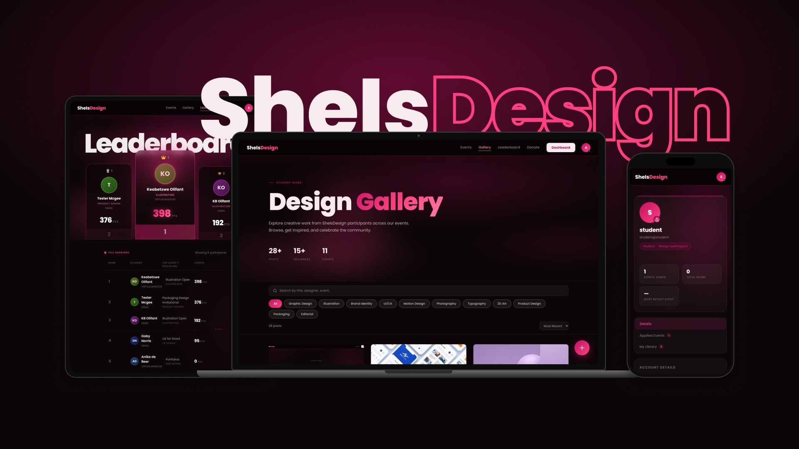

<div align="center">

# SheIsDesign

**A community platform celebrating, challenging and elevating female students in design.**

Built with React · .NET · PostgreSQL · Packaged with Electron

[▶ Demo video](https://drive.google.com/file/d/1Vuk0S-6KSA4xeNBTiyUunoKhHjJYpbML/view?usp=sharing) &nbsp;·&nbsp;
[Presentation](https://www.figma.com/slides/FDR25zYjXFTsmbLN681JkI) &nbsp;·&nbsp;
[Figma design file](https://www.figma.com/design/3iPXXomn08rmvUxEBEykBZ/SheisDesign-DV300) &nbsp;·&nbsp;
[Trello board](https://trello.com/b/P1MS94fg/dv300-semester-1)

</div>

---

## Overview

SheIsDesign is a full-stack web platform that supports and celebrates female design students across South Africa. Students and industry professionals register, enter monthly design challenges, submit their work and track their progress on a live leaderboard. Industry judges score submissions in their own portal, and administrators run events, participants, the gallery and donations from a dark-mode admin dashboard built to WCAG AA accessibility standards.

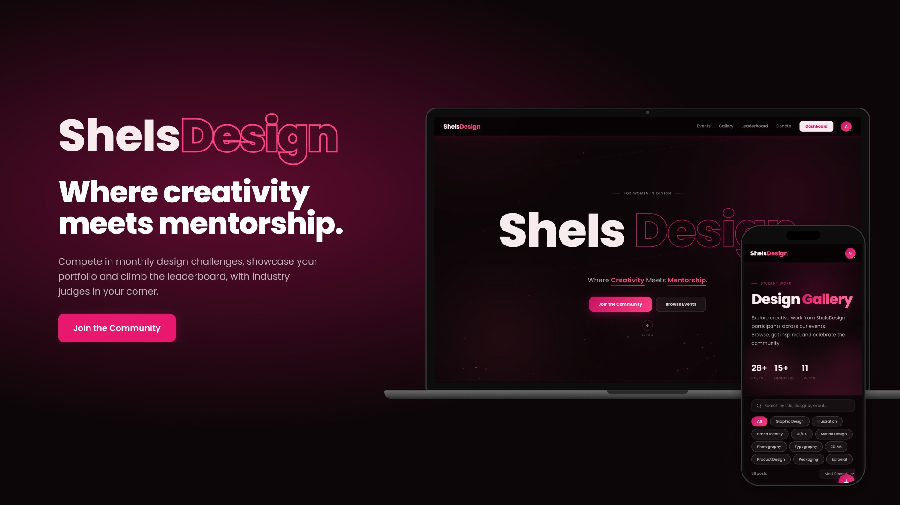

---

## Key Features

<table>
  <tr>
    <td width="33%">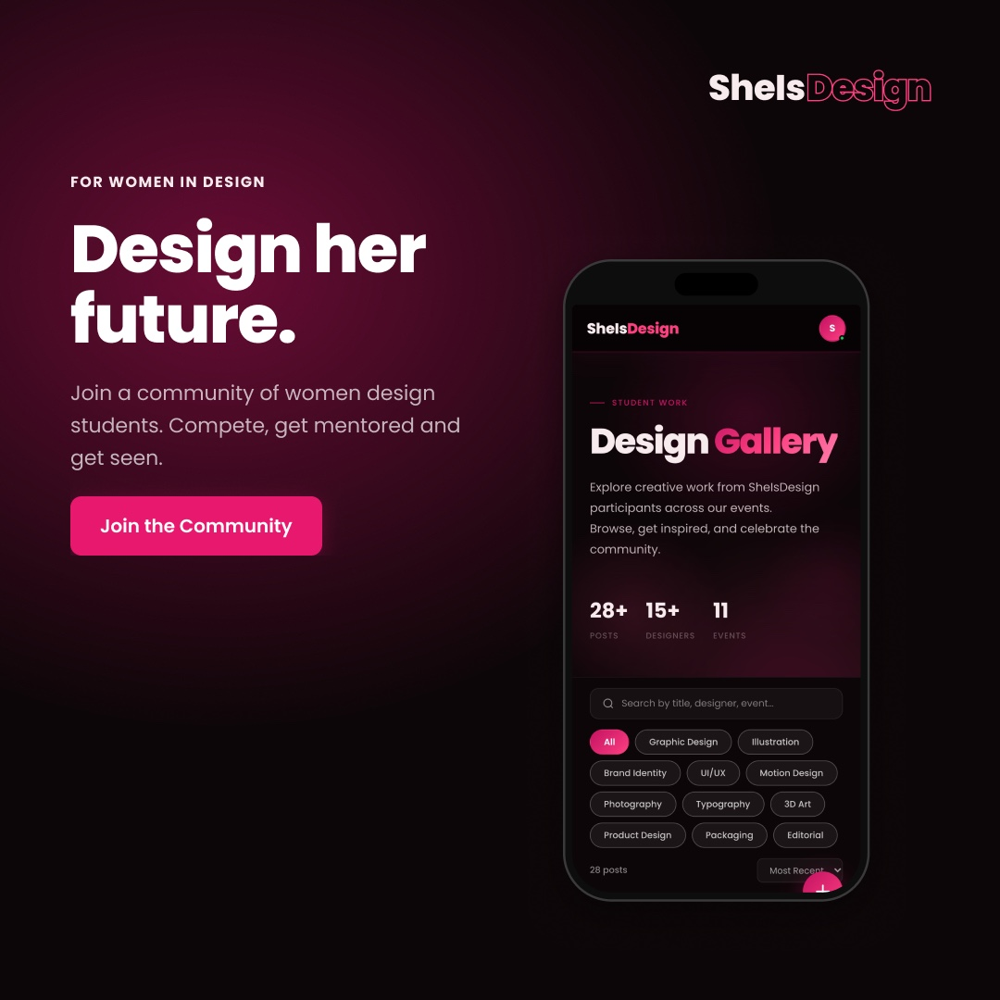</td>
    <td width="33%">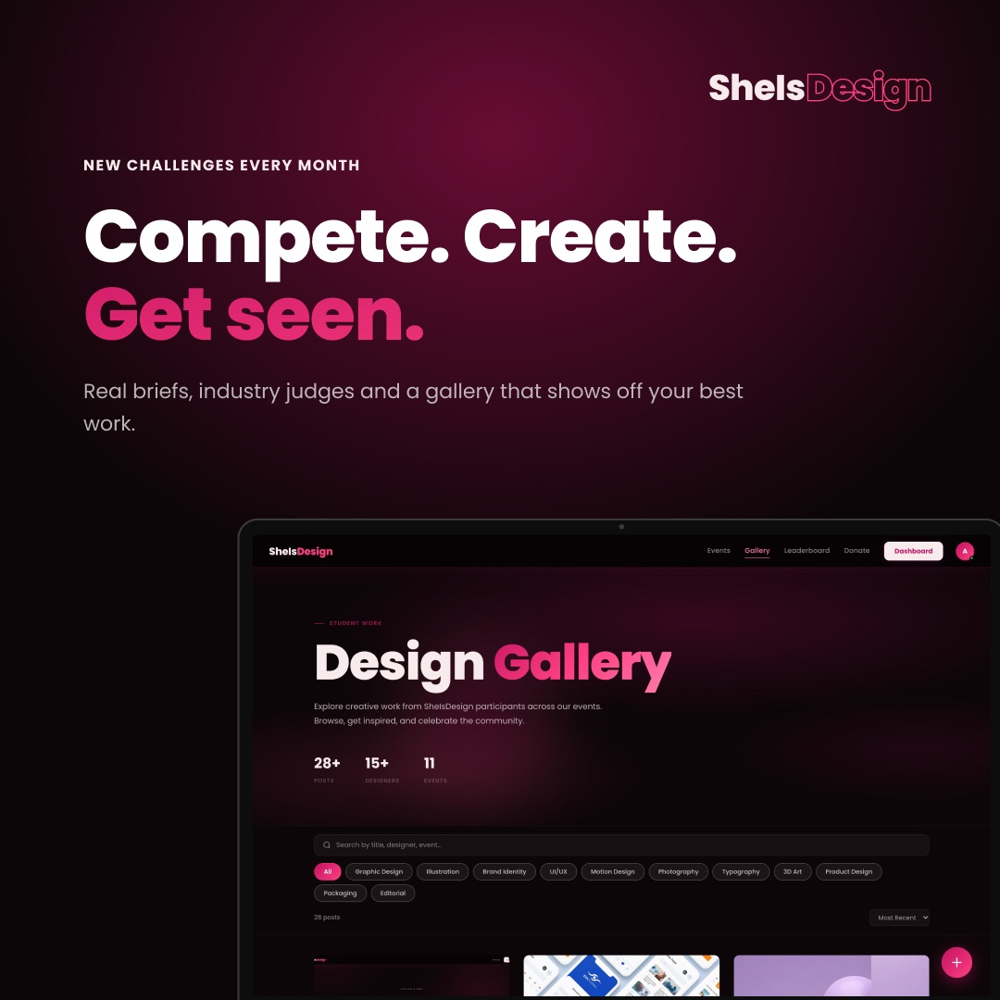</td>
    <td width="33%">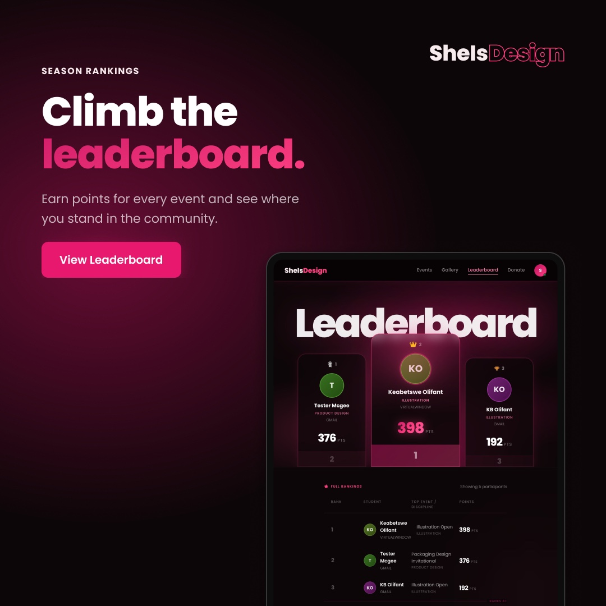</td>
  </tr>
  <tr>
    <td valign="top"><b>Join the community</b><br/>Students sign up with email or Google, verify with a one-time code and get approved by an admin before entering events.</td>
    <td valign="top"><b>Monthly challenges & gallery</b><br/>Real design briefs every month. Submissions land in a public gallery where the community can browse and comment.</td>
    <td valign="top"><b>Live leaderboard</b><br/>Judge scores turn into points, and the leaderboard ranks every student in real time.</td>
  </tr>
</table>

### Role-based dashboards

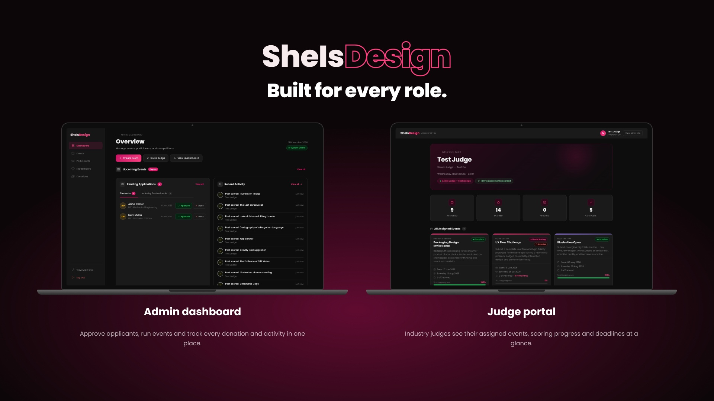

- **Admin interface**: a control centre for platform administrators to approve applicants and manage events, participants, galleries, donations and the leaderboard.
- **Judge scoring system**: a dedicated portal with a task-oriented flow and backend scoring logic, so judges can review and score student work cleanly.

### Gamification & engagement

- **Live competition leaderboard**: calculates competition points and renders live rankings from validated judge scores.
- **Serverless transactional messaging**: EmailJS sends emails (like sign-up codes) straight from the frontend, so the backend needs no SMTP server.

### Donations system

Incoming donations are split across three platform pillars:

- **Events & competitions**: prize pools, logistics and running the design challenges.
- **Student resources**: academic materials, software access and learning tools.
- **Community workshops**: regional training sessions, guest lectures and design masterclasses.

---

## Tech Stack

| Layer               | Technology             | Purpose                                     |
| ------------------- | ---------------------- | ------------------------------------------- |
| **Frontend**        | React (CRA) + DaisyUI  | SPA UI, responsive layout, components       |
| **Backend**         | .NET 10 (C#)           | Contexts, Models, Controllers and DTOs      |
| **Testing**         | Jest + xUnit           | TDD: unit, integration and component tests  |
| **Database**        | PostgreSQL (Aiven)     | Relational data for the ERD schema          |
| **HTTP client**     | Axios                  | Frontend ↔ backend requests                 |
| **Deployment**      | Render (backend)       | CI/CD and hosting                           |
| **Packaging**       | Electron               | Desktop app                                 |
| **Version control** | GitHub                 | Commits, branches and pull requests         |

---

## UI & Brand Style

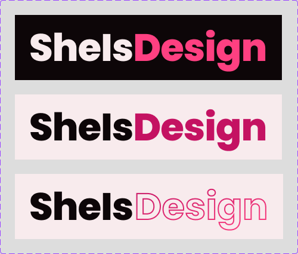

- **The client's vision**: the client asked for a pink-centric colour scheme paired with the modern Poppins typeface. The design challenge was honouring that palette while keeping the platform sophisticated, accessible and appealing to a broad range of design students.
- **Colour palette (dark-mode elegance)**: inspired by the neon fluid energy of our moodboard, the vibrant pinks sit on a deep, premium dark canvas. Primary Magenta (#C41262) and Secondary Pink (#FE4081) carry the highlights, with Blush (#F8EBED) for light text and surfaces, all meeting WCAG AA contrast.
- **Typography**: Poppins throughout, on a strict scale from bold statement headings down to readable interface body text (13–14px, weight 400, 1.6 line height).
- **Layout & components**: a responsive 12-column grid for desktop and Electron breakpoints, smooth micro-interactions, clear status chips (Active, Pending, Rejected) and soft rounded containers (8–16px radius) for an approachable, modular look.

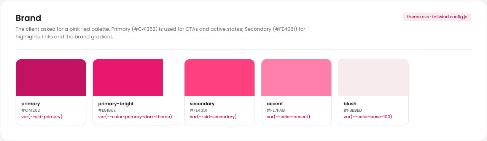

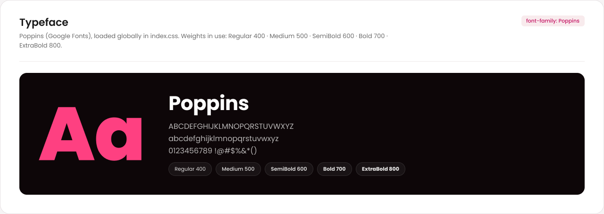

### Moodboard


### Wireframes

Low-fidelity wireframes came first, before the brand was applied.

<table>
  <tr>
    <td width="33%">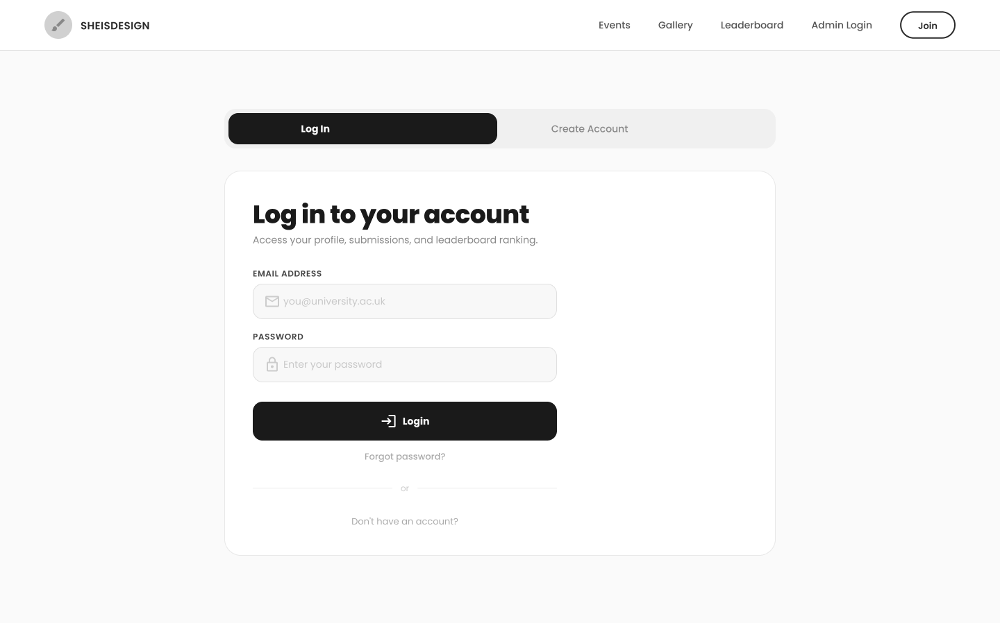</td>
    <td width="33%">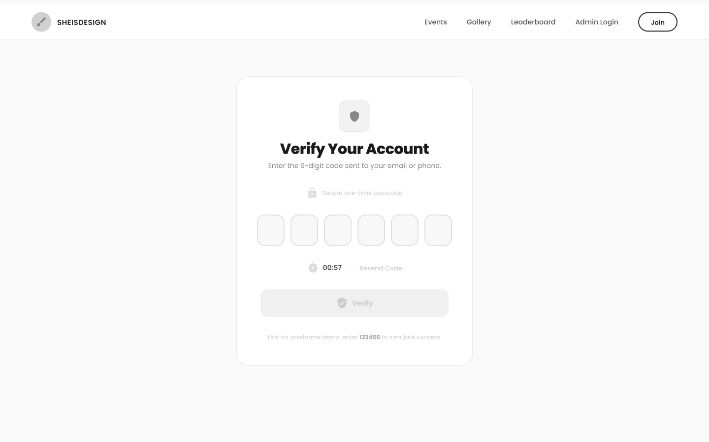</td>
    <td width="33%">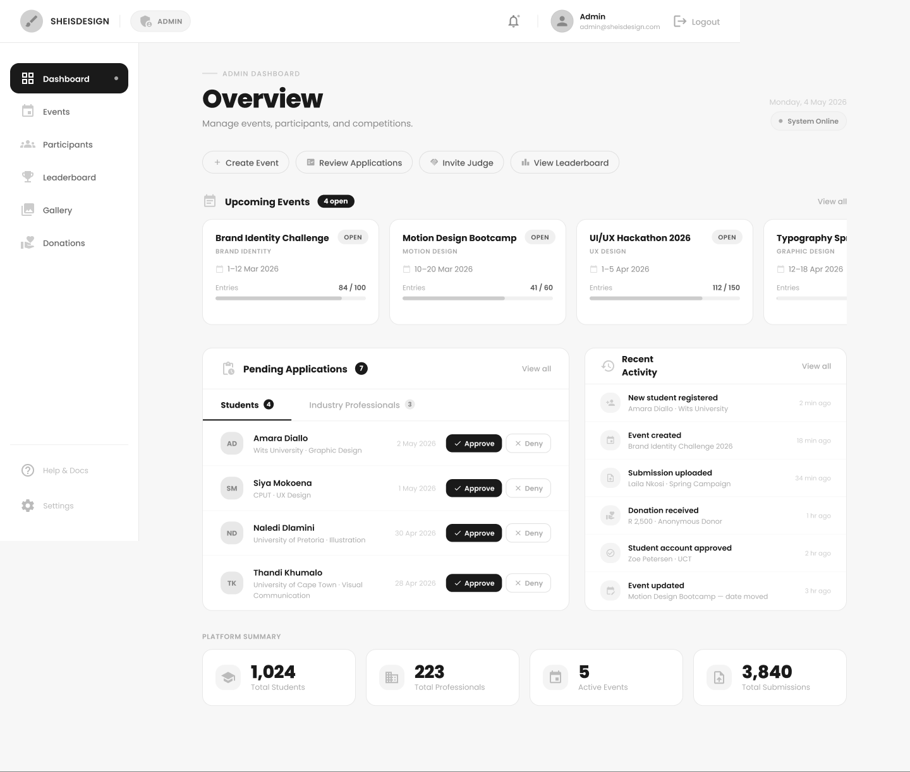</td>
  </tr>
  <tr>
    <td align="center">Log in</td>
    <td align="center">One-time code</td>
    <td align="center">Admin overview</td>
  </tr>
</table>

### Event poster

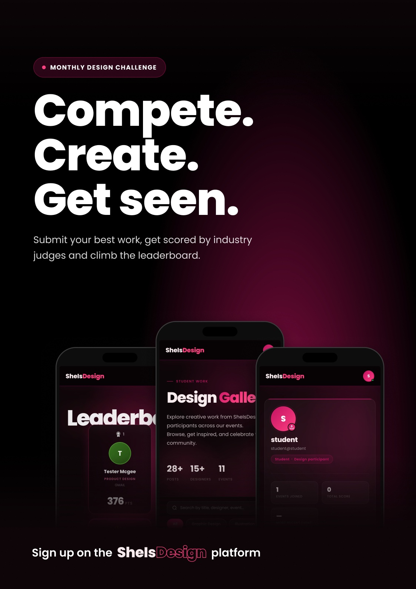

---

## Getting started

### Prerequisites

- Node.js and npm (React `>= 19.2.4`)
- .NET SDK `>= 10`

### 1. Clone the repository

```bash
git clone https://github.com/GabyNor05/SheIsDesign.git
cd SheIsDesign
```

### 2. Backend

The backend needs a `backend/appsettings.json` file with the database connection string (`ConnectionStrings:SheIsDesignDatabase`) and the `AdminAccessCode`. It's git-ignored, so ask the team for it. Never commit it.

```bash
cd backend
dotnet run
```

The API runs at [http://localhost:5160](http://localhost:5160).

### 3. Frontend

The frontend needs a `frontend/.env` file with `REACT_APP_GOOGLE_CLIENT_ID`, `REACT_APP_EMAILJS_SERVICE_ID`, `REACT_APP_EMAILJS_TEMPLATE_ID` and `REACT_APP_EMAILJS_PUBLIC_KEY`. Without it, the login and sign-up page won't load. It's git-ignored too.

```bash
# In a new terminal
cd frontend
npm install
npm start
```

The app opens at [http://localhost:3000](http://localhost:3000).

---

## 🛢 Database Schema (ERD Summary)

The database schema is designed for a highly relational, scalable and secure platform. It centres on Users, Students and Events, plus community interactions (Posts, Comments, Submissions and Donations).

#### Key architectural standards

- **3rd Normal Form (3NF)**: the database is normalised to 3NF. This removes redundancy, prevents update anomalies and makes every non-key attribute depend only on the primary key.
- **No many-to-many relationships**: to protect data integrity and query performance, complex relationships are resolved with one-to-many constraints (for example, separating User credentials from Student profiles, and mapping Donations directly to Events).

#### Core entities & relationships

- **User & Student**: authentication and role-based access. A base User maps to a detailed Student profile with university and academic details.
- **Event & Donation**: each Donation links to a specific EventID for transparent financial allocation.
- **Post & Comment**: Posts tie back to events, and Comments connect to the User who wrote them.
- **Submission**: competition entries, status, points and leaderboard rank, linked to a StudentID.

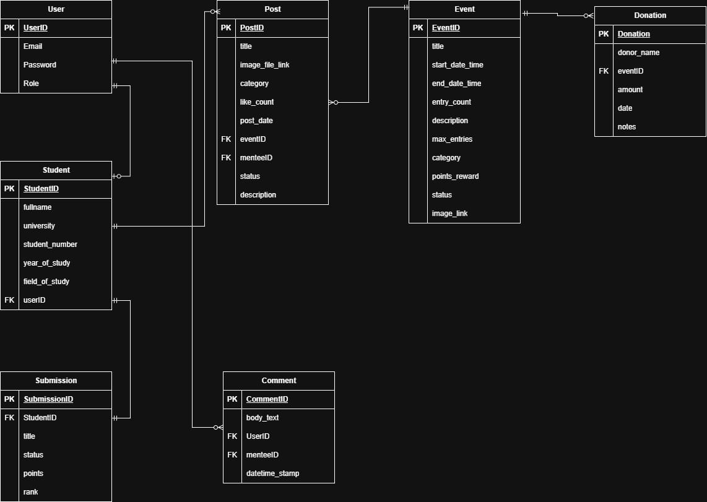

---

## Deployment Process

#### Backend (.NET + C#)
Deployed on **Render**. Handles data requests, authentication and database communication.

#### Database (PostgreSQL)
Hosted on **Aiven**. Credentials live in `appsettings.json` in the backend, which is git-ignored.

---

## Reflection

Building SheIsDesign was a transformative journey that pushed our team to evolve from individual developers into a cohesive, full-stack engineering team. Navigating the integration of a React frontend packaged with Electron, a .NET backend, and a 3NF-compliant PostgreSQL database required immense technical adaptability and precision. Overcoming critical roadblocks—such as configuring secure Google Cloud permissions, managing complex component-based states, establishing isolated unit-testing frameworks with mock services, and executing fluid database migrations—forced us to adopt rigorous debugging and optimisation standards. This process significantly sharpened our understanding of server-client architecture, serverless data pipelines, and strict data contracts, transforming major technical hurdles into deep learning experiences.

Beyond the technical architecture, this project was a masterclass in cross-functional collaboration and user-centric design. We successfully balanced highly technical administrative requirements—like designing task-oriented workflows for Admin and Judge dashboards—with strict accessibility and visual identity goals, building lightweight, library-free CSS animations that perform beautifully. When individual bottlenecks arose in testing or UI modularity, we leveraged internal peer mentoring and agile prototyping to keep the team unblocked. Ultimately, SheIsDesign stands as a testament to our team's shared resilience, proving that intentional, high-fidelity community platforms are built at the intersection of clean engineering and collaborative problem-solving.

### Proud Moments
- **Keagan**: Engineered a robust frontend functions library that abstracted complex API interactions into clean, reusable data-fetching pipelines, strictly maintaining a separation of concerns and alleviating backend workloads. Additionally, partnered closely with **Gaby** throughout the system development life cycle (SDLC) to bridge frontend requirements and backend logic, successfully implementing state management, business rules, and UI layouts for the intricate Judge scoring system and real-time event management features.
- **Anika**: Brought the SheIsDesign visual brand to life by authoring custom, fluid, floating orb animations that run across key landing sections. By building these directly with vanilla CSS keyframes and JSX, a high-fidelity visual aesthetic was achieved with zero external library overhead, keeping the application bundle lightweight, performant, and optimised for load speed.
- **Gaby**: Modernised the platform's communication flow by integrating EmailJS to handle automated user messaging directly from the frontend UI, eliminating the need to configure a traditional backend SMTP server while minimising infrastructure complexity. Furthermore, successfully designed and implemented the structural layouts for both the Admin and Judge dashboards, creating a highly logical, task-oriented user flow that aligned perfectly with the client's administrative needs.
- **Keabetswe (KB)**: Architected the entire database access layer from the ground up by building out all relational Models, API Controllers, Data Transfer Objects (DTOs), and DbContext handlers before successfully hosting the production PostgreSQL instance on Aiven. Additionally, co-authored and optimised critical backend utility methods within the common frontend functions library to establish clean, reliable data contracts across the stack.

### Challenges & Solutions

**Keagan**
- **Challenges**: Struggled with negotiating Google Cloud services and navigating organisational permissions, which delayed implementing Google Login. Also faced difficulties setting up a frontend unit testing framework independent of backend availability.
- **Solutions**: Utilised mock services to isolate and test frontend features individually without relying on live backend endpoints.

**Anika**
- **Challenges**: Diagnosing a post-submission error that required tracing the mismatch between frontend data and backend expectations. Managing CSS conflicts as the project grew, with modal styles bleeding into page-level stylesheets. Balancing the overall design and feel of the website, as the brief required a pink colour scheme, while still needing to attract a wide audience of young students.
- **Solutions**: Fixed the submission error by correcting the data sent from the frontend form. Scoped modal CSS using a dedicated file and ptl- class prefix to prevent style conflicts. Built fully animated visuals, including floating orbs, rotating shapes and pulsing rings, directly in JSX with no external dependencies, replacing all image placeholders across the Support and CTA sections.

**Gaby**
- **Challenges**: Struggled with shifting from monolithic frontend structures to true component-based development, ensuring modularity and reusability across the application. Additionally, faced architectural roadblocks when deciding how to structure and separate the distinct user flows for the Admin and Judge dashboards/portals. Testing also proved to be a major hurdle due to the complexity of the integrated features.
- **Solutions**: Actively collaborated with **Anika** to deepen my understanding of component-based development, successfully implementing a clean component architecture. To resolve the dashboard dilemma, I utilised an agile, iterative approach—diving into rapid prototyping to see what worked visually and functionally, while continuously consulting the team for design alignment. When testing stalled, I paired up with **Keabetswe** (KB) to troubleshoot and successfully implement the required test suites.

**KB**
- **Challenges**: The challenges that this project has produced, at least the ones discovered by me, were the database structure changes. Since the database structure is permanent, it is not easy to change. Unit Testing has also been a difficult part of development due to the sheer number of tests required in a large codebase and the many components that need to be tested.
- **Solutions**: My Solution to the database issue was to attempt to manipulate the migrations feature to undo the structures and redo them with a few commands from the command line. This has been my method of improvisation. Furthermore, a unit testing library was used to assess how much of the codebase had been unit tested, determine how much more testing was needed, and ensure that close communication with my teammates was crucial for this part to avoid conflicts and work efficiently.

---

## Demo Video

[Watch the demo video](https://drive.google.com/file/d/1Vuk0S-6KSA4xeNBTiyUunoKhHjJYpbML/view?usp=sharing)

## Final Presentation Slide Show

[View the presentation](https://www.figma.com/slides/FDR25zYjXFTsmbLN681JkI)

---

## Contributing

1. Fork the repository
2. Create a feature branch: `git checkout -b feature/your-feature-name`
3. Commit your changes: `git commit -m "feat: add your feature"`
4. Push to the branch: `git push origin feature/your-feature-name`
5. Open a Pull Request

### Commit Convention

This project follows [Conventional Commits](https://www.conventionalcommits.org/):

```
feat:     New feature
fix:      Bug fix
style:    Visual/styling changes (no logic change)
refactor: Code restructure
docs:     Documentation only
chore:    Build, config, tooling
```

---

## Authors

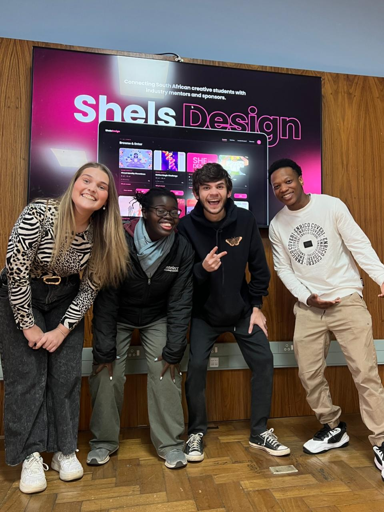

<a href="https://github.com/GabyNor05/SheIsDesign/graphs/contributors">
  
</a>

Made with [contrib.rocks](https://contrib.rocks).

---

## License

Distributed under the MIT License. See [LICENSE](./LICENSE) for more information.

---

<div align="center">

**SheIs**Design &nbsp;·&nbsp; Built with 🤍 in South Africa &nbsp;·&nbsp; DV300 · 2026

</div>
